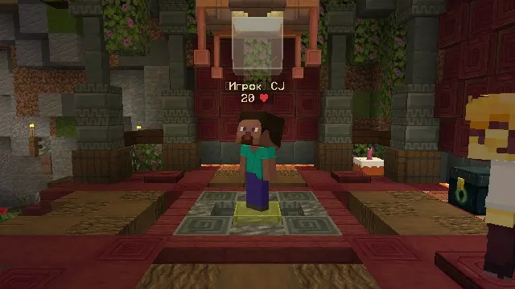
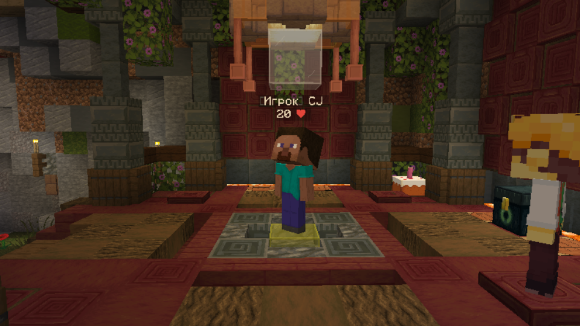
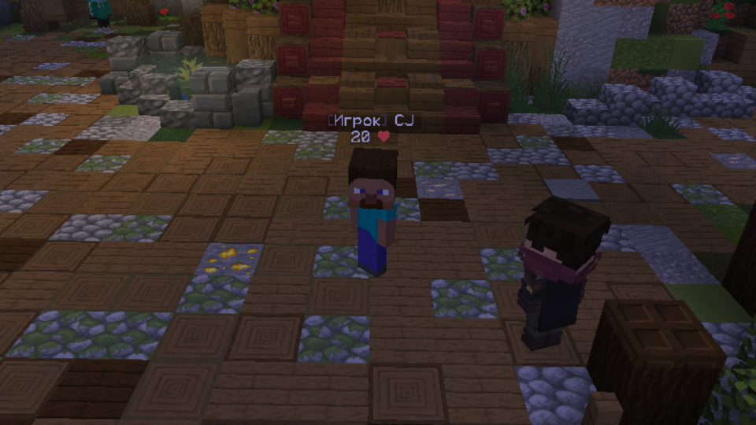
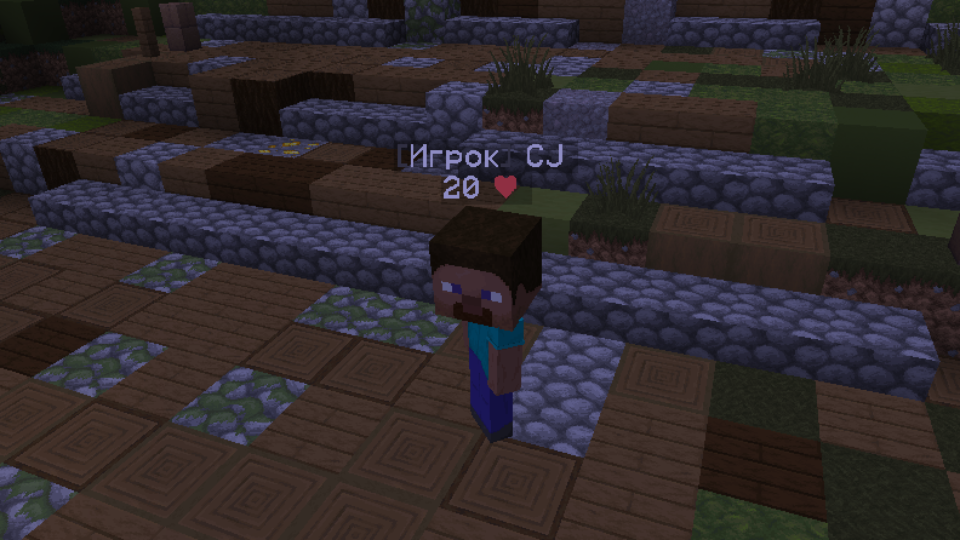

<div align="center">

# Flashback Director MCP

Local Fabric addon and zero-dependency MCP server for **Minecraft 26.2 / 26.3** and **Flashback**.
Control replays, scan highlights, validate camera collisions, build editable keyframes, inspect frames, and export video directly from your AI client.

[](https://github.com/seetch/flashback-director-mcp/releases/tag/v0.1.2)
[](https://github.com/seetch/flashback-director-mcp/releases/latest)
[](https://adoptium.net/)
[](https://nodejs.org/)
[](LICENSE)

**English** · [Русский](README.ru.md)

[Demo](#demo) · [Features](#features) · [Quick Start](#quick-start) · [Build from Source](#build-from-source) · [Security](#security)

</div>

---

## Demo

<p align="center">
  <a href="https://github.com/seetch/flashback-director-mcp/releases/download/v0.1.2/demo-final-cut.mp4">
    
  </a>
</p>

<p align="center">
  <sub>
    Generated and exported inside Minecraft 26.2 (<code>Flashback 0.43.6</code>) via MCP tools: highlight scan, path collision check, per-entity NPC/hologram nametag hiding, 3-shot montage with speed-ramps, and 1080p60 render.
    <br>
    <a href="https://github.com/seetch/flashback-director-mcp/releases/download/v0.1.2/demo-final-cut.mp4"><strong>Watch / Download full 1080p 60fps MP4 (41.9 MB)</strong></a>
  </sub>
</p>

<table align="center">
  <tr>
    <td align="center"><br><sub>1. Spawn Reveal</sub></td>
    <td align="center"><br><sub>2. Courtyard Parallax</sub></td>
    <td align="center"><br><sub>3. Canopy Hero Push</sub></td>
  </tr>
</table>

---

## Features

| Area | Capabilities |
| --- | --- |
| **Replay & Playback** | List, open, and close replays; play, pause, speed control, and settled tick/second seeking. |
| **Scouting & Collisions** | Scan tick windows for movement, jump, combat, and entity-cluster highlights (`director_scan_highlights`); raycast camera splines and line of sight against loaded blocks (`director_check_path`). |
| **Timeline & Keyframes** | Manage scenes, tracks, and undo/redo history using native Flashback history actions; edit `CAMERA`, `FOV`, `SPEED`, `TIMELAPSE`, `TIME_OF_DAY`, `FREEZE`, `CAMERA_SHAKE`, `CAMERA_ORBIT`, and `TRACK_ENTITY` tracks. |
| **Shot Presets** | Generate editable Flashback keyframes for `flyover`, `orbit`, `dolly_reveal`, `follow_parallax`, and `impact_freeze` with automatic obstacle avoidance (`director_create_shot`). |
| **Visuals & Nametags** | Toggle HUD, weather, time of day, fog, and per-entity nametag visibility (`hideNametags`, `addHiddenNametags`, `removeHiddenNametags`, `keepNametagsOnlyFor`) to hide NPC and hologram text while keeping chosen players visible. |
| **Previews & Export** | Capture Vulkan-safe PNG previews via Blaze3D (`director_screenshot`) and trigger Flashback video/WebP/GIF exports (`director_export_video`). |

---

## Requirements

| Component | Requirement |
| --- | --- |
| Minecraft | `26.2` or `26.3` (Fabric) |
| Java | `25+` |
| Fabric Loader | `0.19.3+` (26.2) / `0.19.5+` (26.3) |
| Fabric API | Matching Minecraft version |
| Flashback | `0.43.3+` (26.2) / `0.43.4+` (26.3) |
| Node.js | `18+` (for the zero-dependency `stdio` bridge) |

---

## Quick Start

### 1. Install the mod and MCP server

Download the files for your Minecraft version from [Releases](https://github.com/seetch/flashback-director-mcp/releases/latest):

- Put `flashback-director-mcp-0.1.2+mc26.2.jar` (or `+mc26.3.jar`) into your Minecraft profile's `mods` folder alongside **Fabric API** and **Flashback**.
- Save `flashback-director-mcp.mjs` in a permanent local folder (no `npm install` needed).

### 2. Connect your AI client

Generate a ready-to-merge config snippet with absolute paths:

```powershell
node "C:\path\to\flashback-director-mcp.mjs" --print-config antigravity
```

Supported `--print-config` targets: `antigravity`, `cursor`, `claude`, `vscode`, `generic`.

Optional: copy `skills/flashback-director/SKILL.md` into your AI client's skills folder for a structured multi-shot cinematography workflow.

### 3. Enable in Minecraft

1. Launch Minecraft in **windowed mode (`F11`)** if you plan to take screenshots or export video.
2. Click **MCP: OFF** in the top-right corner of the title screen or pause menu to switch it to **MCP: ON**.
3. Call `director_status` from your AI client to verify the connection.

---

## Build from Source

Flashback is proprietary and is **not** distributed in this repository.

1. Place your local Flashback JAR in `libs/` (ignored by Git):
   - `libs/Flashback-0.43.6-for-MC26.2.jar` for Minecraft `26.2`
   - `libs/Flashback-for-MC26.3.jar` for Minecraft `26.3`
2. Run Gradle with JDK 25:
   ```powershell
   .\gradlew.bat :mc-26.2:build
   .\gradlew.bat :mc-26.3:build
   ```
3. Compiled JARs appear in `mc-26.2/build/libs/` and `mc-26.3/build/libs/`.

---

## Security

- Disabled by default on first launch; enabled manually via the in-game button.
- Binds exclusively to `127.0.0.1` on an ephemeral port.
- Generates a fresh 256-bit Bearer token on every start, saved to `~/.flashback-director-mcp/bridge.json` with owner-only file permissions and removed on stop/exit.
- Hard 2 MB request body limit; zero external network requests, zero npm dependencies, zero telemetry.

---

## Project Layout

```text
core/             Pure Java 25 HTTP bridge, auth, JSON parser, 22-tool dispatcher, spline math & highlight scorer
fabric-shared/    Shared Fabric layer: client-thread executor, Level.clip collision checker, Blaze3D screenshots
mc-26.2/          Minecraft 26.2 + Flashback adapter and Mixin accessors
mc-26.3/          Minecraft 26.3 (SDL/Vulkan) + Flashback adapter and Mixin accessors
mcp-server/       Standalone zero-dependency Node.js stdio MCP server
skills/           Director cinematography workflow skill for AI clients
```

---

## License

Copyright (c) 2026 seetch. **All Rights Reserved.** See [LICENSE](LICENSE) for full terms.

Viewing source code, building from source, and personal non-commercial use are permitted. Redistribution, re-uploading, modification, derivative works, and commercial use are prohibited without prior written permission.
