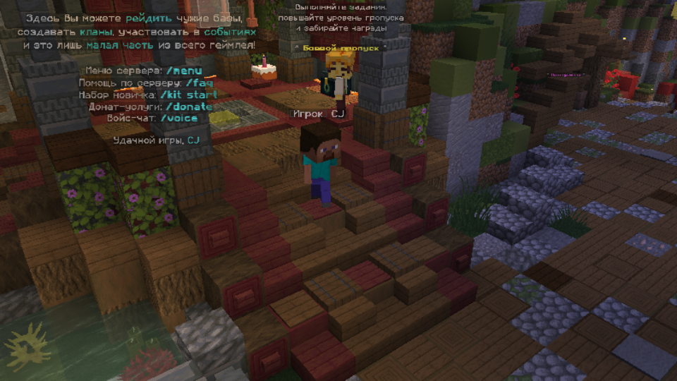

# Flashback Director MCP

[English](README.md) · **Русский**

Локальный Fabric-аддон для **Minecraft 26.2 / 26.3** и **Flashback** с однофайловым `stdio` MCP-сервером на Node.js без сторонних зависимостей. Позволяет ИИ-клиенту находить интересные моменты в реплее, проверять траектории камеры на столкновения с блоками, собирать редактируемые кейфреймы в Flashback, проверять кадры скриншотами и запускать экспорт видео.




*Кадры построены и проверены вживую в Minecraft 26.2 (`Flashback 0.43.6`) через `director_check_path`, `director_set_keyframes` и `director_screenshot`.*

## Возможности

- **22 инструмента MCP**: управление реплеями, воспроизведением, сценами, дорожками, кейфреймами (`CAMERA`, `FOV`, `SPEED`, `TIMELAPSE`, `TIME_OF_DAY`, `FREEZE`, `CAMERA_SHAKE`, `CAMERA_ORBIT`, `TRACK_ENTITY`), визуалом, историей undo/redo и экспортом видео.
- **Проверка коллизий (`director_check_path`)**: рейкаст и проверка зазора от блоков в загруженном мире, чтобы камера не влетала в стены, потолки и листву.
- **Сканер моментов (`director_scan_highlights`)**: проход по диапазону тиков для поиска всплесков скорости, прыжков/падений, получения урона и скоплений сущностей.
- **Режиссёрские пресеты (`director_create_shot`)**: генерация обычных редактируемых кейфреймов Flashback для планов `flyover`, `orbit`, `dolly_reveal`, `follow_parallax` и `impact_freeze` с автоматическим обходом препятствий.
- **Скриншоты через Blaze3D (`director_screenshot`)**: захват PNG через штатный пайплайн Minecraft без сырых вызовов OpenGL (совместимо с Vulkan в 26.2+) и передача картинки напрямую в ИИ.
- **Ноль npm-зависимостей**: один скрипт `mcp-server/flashback-director-mcp.mjs`, подключающийся к игре строго по `127.0.0.1` с одноразовым 256-битным токеном.

## Требования

| Компонент | Версия |
| --- | --- |
| Minecraft | `26.2` или `26.3` (Fabric) |
| Java | `25+` |
| Fabric Loader | `0.19.3+` (26.2) / `0.19.5+` (26.3) |
| Fabric API | Под вашу версию Minecraft |
| Flashback | `0.43.3+` (26.2) / `0.43.4+` (26.3) |
| Node.js | `18+` |

## Сборка из исходников

У Flashback проприетарная лицензия - его JAR **не включён** в репозиторий.

1. Положите локальную копию JAR Flashback в папку `libs/` (исключена в `.gitignore`):
   - `libs/Flashback-0.43.6-for-MC26.2.jar` для Minecraft `26.2`
   - `libs/Flashback-for-MC26.3.jar` для Minecraft `26.3`
2. Соберите нужную версию на JDK 25:
   ```powershell
   .\gradlew.bat :mc-26.2:build
   # Для 26.3 (при наличии libs/Flashback-for-MC26.3.jar):
   .\gradlew.bat :mc-26.3:build
   ```
3. Скопируйте собранный `.jar` из `mc-26.2/build/libs/` в папку `mods` вашего профиля Minecraft.

## Подключение к MCP-клиенту

Сгенерируйте фрагмент конфигурации с вашими абсолютными путями:

```powershell
node "C:\путь\к\flashback-director-mcp\mcp-server\flashback-director-mcp.mjs" --print-config antigravity
```

Поддерживаемые значения `--print-config`: `antigravity`, `cursor`, `claude`, `vscode`, `generic`.

По желанию скопируйте `skills/flashback-director/SKILL.md` в папку скиллов вашего ИИ-клиента, чтобы модель следовала пошаговому режиссёрскому пайплайну.

## Использование в игре

1. Запустите Minecraft в **оконном режиме (`F11`)**, если планируете снимать скриншоты и экспортировать видео.
2. Нажмите кнопку **MCP: OFF** в правом верхнем углу главного меню или меню паузы - она переключится в **MCP: ON**.
3. В ИИ-клиенте вызовите `director_status` для проверки соединения, затем попросите открыть реплей и собрать пролётки.

## Безопасность

- При первом запуске мост выключен по умолчанию и включается вручную кнопкой в меню.
- Сервер слушает только `127.0.0.1` на случайном свободном порту.
- При каждом запуске генерируется новый 256-битный Bearer-токен в `~/.flashback-director-mcp/bridge.json` с правами только для текущего пользователя ОС; при выключении файл удаляется.
- Размер тела запроса ограничен 2 МБ; нет телеметрии и внешних сетевых вызовов.

## Структура проекта

- `core/` - чистая Java 25: локальный HTTP-сервер, авторизация, JSON-парсер, диспетчер 22 инструментов, математика сплайнов, пресеты и скоринг моментов.
- `fabric-shared/` - общий слой Fabric: выполнение в клиентском потоке, проверка коллизий мира, Blaze3D-скриншоты и конфиг.
- `mc-26.2/` и `mc-26.3/` - адаптеры под конкретные версии Flashback и Mixin-аксессоры.
- `mcp-server/` - автономный `stdio` MCP-сервер на Node.js без зависимостей.
- `skills/flashback-director/` - режиссёрский скилл для ИИ-ассистента.

## Лицензия

Copyright (c) 2026 seetch. **All Rights Reserved.** Полные условия приведены в [LICENSE](LICENSE).
Разрешены просмотр исходного кода и личное некоммерческое использование; распространение, изменение, перезалив и создание производных работ без письменного разрешения правообладателя запрещены.
