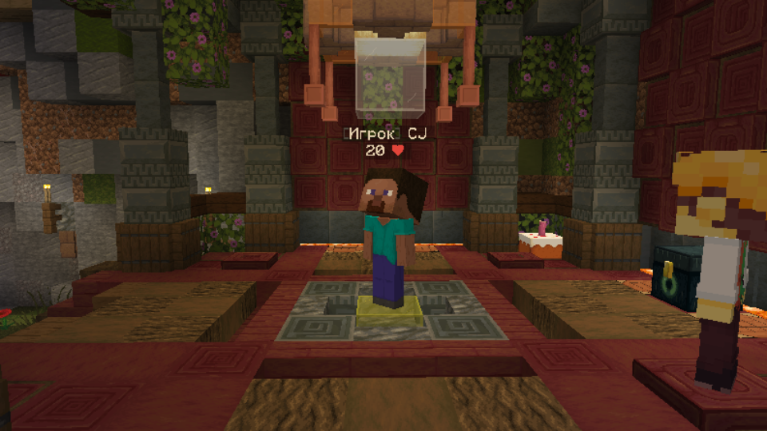
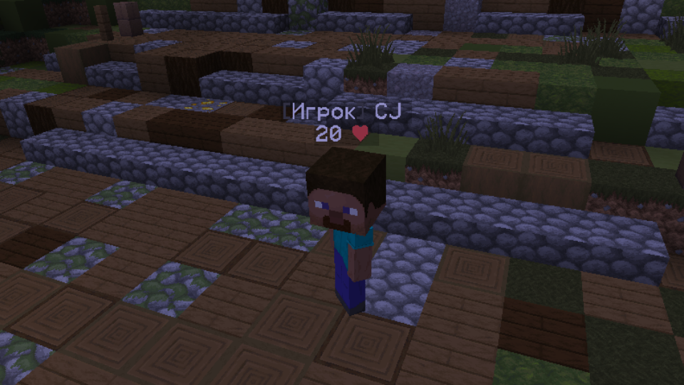

<div align="center">

# Flashback Director MCP

Локальный Fabric-аддон и автономный MCP-сервер без зависимостей для **Minecraft 26.2 / 26.3** и **Flashback**.
Позволяет ИИ-клиенту находить сильные моменты в реплее, проверять коллизии камеры с блоками, собирать редактируемые кейфреймы, проверять ракурсы скриншотами и экспортировать видео.

[](https://github.com/seetch/flashback-director-mcp/releases/tag/v0.1.2)
[](https://github.com/seetch/flashback-director-mcp/releases/latest)
[](https://adoptium.net/)
[](https://nodejs.org/)
[](LICENSE)

[English](README.md) · **Русский**

[Демо](#демо) · [Возможности](#возможности) · [Быстрый старт](#быстрый-старт) · [Сборка из исходников](#сборка-из-исходников) · [Безопасность](#безопасность)

</div>

---

## Демо

<p align="center">
  <a href="https://github.com/seetch/flashback-director-mcp/releases/download/v0.1.2/demo-final-cut.mp4">
    
  </a>
</p>

<p align="center">
  <sub>
    Собрано и отрендерено вживую в Minecraft 26.2 (<code>Flashback 0.43.6</code>) через MCP: сканирование моментов, проверка коллизий, выборочное скрытие ников NPC и голограмм, 3-плановый монтаж со speed-ramp и экспорт в 1080p60.
    <br>
    <a href="https://github.com/seetch/flashback-director-mcp/releases/download/v0.1.2/demo-final-cut.mp4"><strong>Смотреть / скачать полное видео 1080p 60fps MP4 (41.9 МБ)</strong></a>
  </sub>
</p>

<table align="center">
  <tr>
    <td align="center"><br><sub>1. План на спавне</sub></td>
    <td align="center"><br><sub>2. Проезд по двору</sub></td>
    <td align="center"><br><sub>3. Проход под кронами</sub></td>
  </tr>
</table>

---

## Возможности

| Раздел | Что умеет |
| --- | --- |
| **Реплеи и воспроизведение** | Список, открытие и закрытие реплеев; пауза, скорость и перемотка по тикам/секундам с ожиданием прогрузки мира. |
| **Разведка и коллизии** | Поиск ярких моментов по всплескам скорости, прыжкам, урону и скоплениям сущностей (`director_scan_highlights`); рейкаст траектории и линии видимости до цели (`director_check_path`). |
| **Таймлайн и кейфреймы** | Управление сценами, дорожками и историей undo/redo через нативные действия Flashback; редактирование `CAMERA`, `FOV`, `SPEED`, `TIMELAPSE`, `TIME_OF_DAY`, `FREEZE`, `CAMERA_SHAKE`, `CAMERA_ORBIT`, `TRACK_ENTITY`. |
| **Режиссёрские пресеты** | Генерация обычных редактируемых кейфреймов для планов `flyover`, `orbit`, `dolly_reveal`, `follow_parallax` и `impact_freeze` с автоматическим обходом препятствий (`director_create_shot`). |
| **Визуал и ники** | Управление HUD, погодой, временем суток, туманом и точечное скрытие имён сущностей (`hideNametags`, `addHiddenNametags`, `removeHiddenNametags`, `keepNametagsOnlyFor`) - можно убрать все голограммы и ники NPC, оставив только нужных игроков. |
| **Превью и экспорт** | Скриншоты через Blaze3D без сырых вызовов OpenGL (`director_screenshot`, совместимо с Vulkan) и экспорт видео/WebP/GIF через Flashback (`director_export_video`). |

---

## Требования

| Компонент | Требование |
| --- | --- |
| Minecraft | `26.2` или `26.3` (Fabric) |
| Java | `25+` |
| Fabric Loader | `0.19.3+` (26.2) / `0.19.5+` (26.3) |
| Fabric API | Под вашу версию Minecraft |
| Flashback | `0.43.3+` (26.2) / `0.43.4+` (26.3) |
| Node.js | `18+` (для `stdio`-моста без зависимостей) |

---

## Быстрый старт

### 1. Установите мод и MCP-сервер

Скачайте файлы под вашу версию Minecraft со страницы [Releases](https://github.com/seetch/flashback-director-mcp/releases/latest):

- Положите `flashback-director-mcp-0.1.2+mc26.2.jar` (или `+mc26.3.jar`) в папку `mods` вашего профиля вместе с **Fabric API** и **Flashback**.
- Сохраните `flashback-director-mcp.mjs` в постоянную папку (`npm install` не требуется).

### 2. Подключите к ИИ-клиенту

Сгенерируйте готовый фрагмент конфигурации с абсолютными путями:

```powershell
node "C:\путь\к\flashback-director-mcp.mjs" --print-config antigravity
```

Поддерживаемые значения `--print-config`: `antigravity`, `cursor`, `claude`, `vscode`, `generic`.

По желанию скопируйте `skills/flashback-director/SKILL.md` в папку скиллов вашего ИИ-клиента, чтобы модель следовала режиссёрскому пайплайну.

### 3. Включите мост в игре

1. Запустите Minecraft в **оконном режиме (`F11`)**, если планируете снимать скриншоты и экспортировать видео.
2. В правом верхнем углу главного меню или меню паузы нажмите кнопку **MCP: OFF** -> она переключится в **MCP: ON**.
3. Вызовите `director_status` из ИИ-клиента для проверки соединения.

---

## Сборка из исходников

У Flashback проприетарная лицензия - его JAR **не включён** в репозиторий.

1. Положите локальную копию JAR Flashback в папку `libs/` (игнорируется Git):
   - `libs/Flashback-0.43.6-for-MC26.2.jar` для Minecraft `26.2`
   - `libs/Flashback-for-MC26.3.jar` для Minecraft `26.3`
2. Запустите Gradle на JDK 25:
   ```powershell
   .\gradlew.bat :mc-26.2:build
   .\gradlew.bat :mc-26.3:build
   ```
3. Готовые `.jar` появятся в `mc-26.2/build/libs/` и `mc-26.3/build/libs/`.

---

## Безопасность

- При первом запуске мост выключен по умолчанию и включается вручную кнопкой в игре.
- Слушает строго `127.0.0.1` на случайном свободном порту.
- На каждый запуск создаёт новый 256-битный Bearer-токен в `~/.flashback-director-mcp/bridge.json` с правами только для текущего пользователя ОС; при выключении или закрытии игры файл удаляется.
- Лимит тела запроса 2 МБ; нет внешних сетевых запросов, сторонних npm-пакетов и телеметрии.

---

## Структура проекта

```text
core/             Чистая Java 25: HTTP-мост, авторизация, JSON-парсер, диспетчер 22 инструментов, математика и скоринг
fabric-shared/    Общий слой Fabric: клиентский поток, проверка коллизий Level.clip, Blaze3D-скриншоты
mc-26.2/          Адаптер Minecraft 26.2 + Flashback и Mixin-аксессоры
mc-26.3/          Адаптер Minecraft 26.3 (SDL/Vulkan) + Flashback и Mixin-аксессоры
mcp-server/       Автономный Node.js stdio MCP-сервер без зависимостей
skills/           Режиссёрский скилл для ИИ-клиентов
```

---

## Лицензия

Copyright (c) 2026 seetch. **All Rights Reserved.** Полные условия приведены в [LICENSE](LICENSE).

Разрешены просмотр исходного кода, сборка из исходников и личное некоммерческое использование. Распространение, перезалив, изменение, создание производных работ и коммерческое использование без письменного разрешения правообладателя запрещены.
